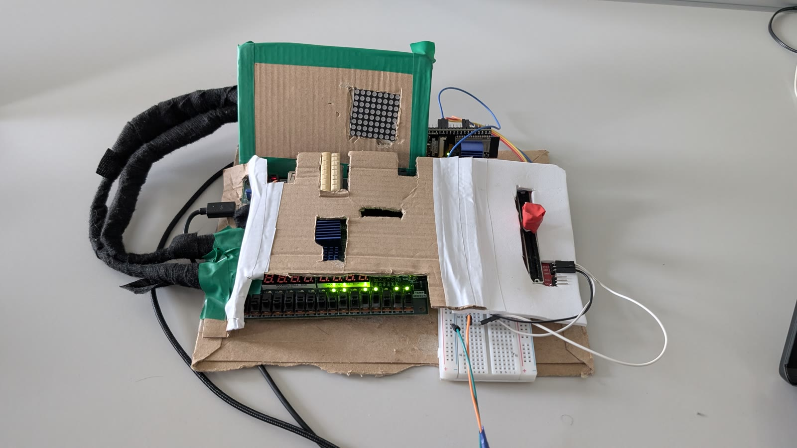
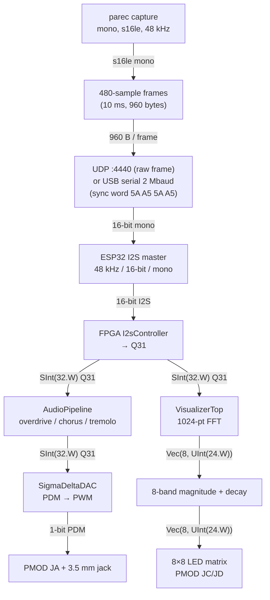

# FPGA-Accelerated Audio Player

Streams desktop audio to a Nexys A7 100T FPGA (over Wi-Fi or USB) for real-time DSP effects and an 8×8 LED FFT spectrum visualizer.

## Demo

https://github.com/mairup/fpga-accelerated-audio-player/assets/112927569/f787bbde-f7e6-406b-864b-af1b3be07e6a

More photos and the full-quality video: [Nextcloud share](https://nextcloud.mairup.space/s/9WNikC9bBXMAaJw).

## Architecture

One audio stream, two destinations on the FPGA: DSP effects out to a speaker, and an FFT spectrum on an 8×8 LED matrix.

### Client — `client/audio_client.py` (Python)

1. Loads a PulseAudio null sink (`fpga_audio_relay`) and sets it as the default output, so desktop audio plays into it.
2. Captures the sink's monitor with `parec` — mono, 16-bit little-endian, 48 kHz, 10 ms latency.
3. Packs samples into 480-sample frames (960 bytes).

`--synth`, `--burst`, `--static-test` generate signals locally instead of capturing.

### Transport (client → ESP32)

- **UDP**: frame sent as-is to `ESP32:4440`. The receiver accepts a datagram only when its size is exactly 960 bytes.
- **USB serial**: frame prefixed with sync word `5A A5 5A A5` (964 bytes total) at 2,000,000 baud. The ESP32 re-synchronizes on that word.

### Bridge — `esp/audio_streamer.toit` (Toit, ESP32)

Runs an I2S master (48 kHz, 16-bit, mono) on SCK=GPIO32, WS=GPIO33, TX=GPIO12. Frames go into a 25-deep queue; playback starts after 5 frames are buffered (silence before that). UART input takes priority over UDP while a UART frame is arriving.

### DSP — `fpga/` (Chisel → Verilog, Nexys A7 100T)

Top module `TopAudioAccelerator`. Decoded 32-bit samples from `I2sController` feed two independent paths:

1. **Audio**: `AudioPipeline` (overdrive → chorus → tremolo) → `SigmaDeltaDAC` (1-bit PDM → PWM) → PMOD JA + 3.5 mm jack.
2. **Visualizer**: `VisualizerTop` — `SampleBuffer` collects 1024 samples, bursts them through a radix-2² SDF FFT, `FFTMagnitudeBinner` sums magnitudes into 8 frequency bands, `FFTTemporalTracker` applies fast-attack/decay. Output drives `LedMatrixVisualizer` (8×8 matrix, PMOD JC/JD, 1 kHz refresh).

Effects are switch-gated: SW0 master out, SW1 FX master, SW2 overdrive, SW3 chorus, SW4 tremolo. SW14 and SW15 both inject a 440 Hz square-wave test tone into the DAC (bypassing the pipeline).

### Timing

- 48 kHz sample rate → 480 samples = 10 ms per frame → 100 frames/s.
- FPGA clock 100 MHz (`create_clock -period 10.0` in the XDC).
- SigmaDeltaDAC interpolates ~2083 clock cycles per sample (100 MHz / 48 kHz).

### Module → file

| Module | File |
|--------|------|
| `TopAudioAccelerator` | `fpga/src/main/scala/fpga/TopAudioAccelerator.scala` |
| `I2sController` | `fpga/src/main/scala/fpga/I2sController.scala` |
| `AudioPipeline` | `fpga/src/main/scala/dsp/AudioPipeline.scala` |
| `Overdrive` / `Chorus` / `Tremolo` | `fpga/src/main/scala/dsp/{Overdrive,Chorus,Tremolo}.scala` |
| `SigmaDeltaDAC` | `fpga/src/main/scala/fpga/SigmaDeltaDAC.scala` |
| `VisualizerTop` | `fpga/src/main/scala/dsp/visualizer/VisualizerTop.scala` |
| `FFTMagnitudeBinner` / `FFTTemporalTracker` / `SampleBuffer` | `fpga/src/main/scala/dsp/visualizer/` |
| `LedMatrixVisualizer` / `LedMatrixDriver` | `fpga/src/main/scala/dsp/visualizer/LedMatrixVisualizer.scala`, `fpga/src/main/scala/fpga/LedMatrixDriver.scala` |
| `UartTransmitter` | `fpga/src/main/scala/fpga/UartTransmitter.scala` |

## More documentation

- [Hardware pin map](docs/hardware-pinmap.md) — every FPGA pin and its function
- [Build & flash](docs/build-and-flash.md) — Docker toolchain and `make` targets

FPGA:

- [DSP effects](docs/fpga/dsp-effects.md) — overdrive, chorus, tremolo
- [I2S receiver](docs/fpga/i2s-receiver.md)
- [Sigma-delta DAC](docs/fpga/sigma-delta-dac.md)
- [FFT visualizer](docs/fpga/fft-visualizer.md)
- [LED matrix](docs/fpga/led-matrix.md)
- [UART telemetry](docs/fpga/uart-telemetry.md)

Other:

- [ESP32 bridge](docs/esp32/streamer.md)
- [Client](docs/client/audio-client.md)
