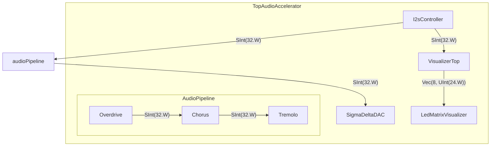

# FPGA design — audio data flow

> Auto-generated from the Chisel sources by `generate_fpga_diagram.py`.
> Do not edit by hand; re-run the script to regenerate.
> Minimal view: audio-data path only (control/telemetry/implementation detail omitted).

