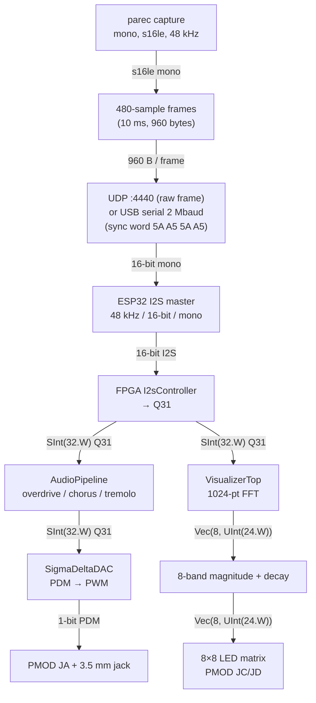

# Data flow

One audio stream, two destinations on the FPGA.

## Capture (Linux client)

1. `audio_client.py` loads a PulseAudio null sink (`fpga_audio_relay`) and sets it as the default output, so desktop audio plays into it.
2. `parec` reads the sink's monitor: mono, 16-bit little-endian, 48 kHz.
3. Samples are packed into 480-sample frames (10 ms). Each frame is 960 bytes.

## Transport (client → ESP32)

- **UDP**: frame sent as-is to `ESP32:4440`. The receiver accepts a datagram only when its size is exactly 960 bytes.
- **USB serial**: frame prefixed with sync word `5A A5 5A A5` (964 bytes total) at 2,000,000 baud. The ESP32 re-synchronizes on that word.

## Bridge (ESP32 → FPGA)

`audio_streamer.toit` runs an I2S master (48 kHz, 16-bit, mono) on SCK=GPIO32, WS=GPIO33, TX=GPIO12. Frames go into a 25-deep queue; playback starts after 5 frames are buffered (silence before that). UART input takes priority over UDP while a UART frame is arriving.

## DSP (FPGA, two parallel paths)

Decoded 32-bit samples from `I2sController` feed two modules:

1. **Audio**: `AudioPipeline` (overdrive → chorus → tremolo, each gated by a switch) → `SigmaDeltaDAC` (1-bit PDM → PWM) → PMOD JA + 3.5 mm jack.
2. **Visualizer**: `VisualizerTop` — `SampleBuffer` collects 1024 samples, bursts them through a radix-2² SDF FFT, `FFTMagnitudeBinner` sums magnitudes into 8 frequency bands, `FFTTemporalTracker` applies fast-attack/decay. Output drives `LedMatrixVisualizer` (8×8 matrix, PMOD JC/JD, 1 kHz refresh).

## Timing

- 48 kHz sample rate → 480 samples = 10 ms per frame → 100 frames/s.
- FPGA clock 100 MHz (`create_clock -period 10.0` in the XDC).
- SigmaDeltaDAC interpolates ~2083 clock cycles per sample (100 MHz / 48 kHz).
